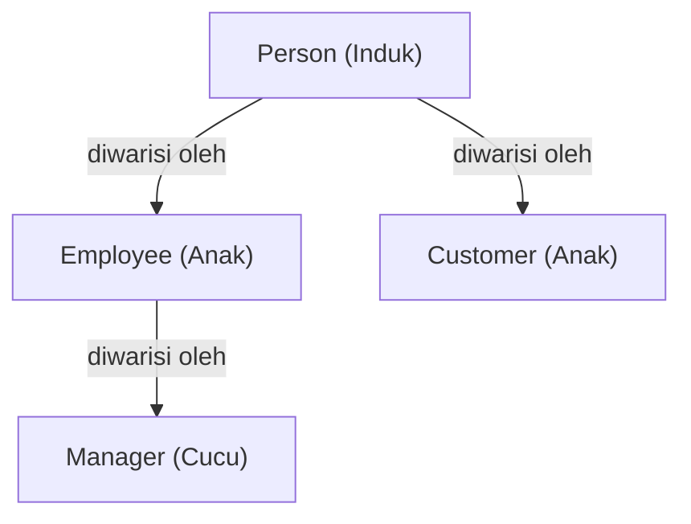
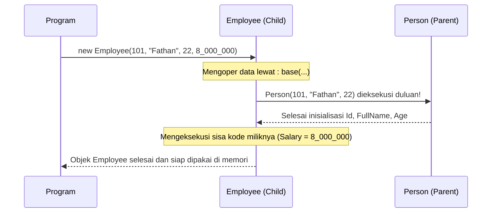

# PANDUAN LENGKAP INHERITANCE DI C# (.NET)
> **Materi:** Bootcamp Backend .NET - Series B (Object-Oriented Programming)  
> **Studi Kasus:** `SeriesB.CInheritence` (`Person` ➔ `Employee`)

---

## DAFTAR ISI
1. [Apa Itu Inheritance (Pewarisan)?](#1-apa-itu-inheritance-pewarisan)
2. [Hubungan "IS-A" (Adalah Sebuah)](#2-hubungan-is-a-adalah-sebuah)
3. [Analogi Dunia Nyata](#3-analogi-dunia-nyata)
4. [Peran Krusial Access Modifier (`protected`)](#4-peran-krusial-access-modifier-protected)
5. [Konstruktor dalam Pewarisan & Keyword `: base(...)`](#5-konstruktor-dalam-pewarisan--keyword--base)
6. [Bedah Kode Nyata (CInheritence)](#6-bedah-kode-nyata-cinheritence)
   - [A. Person.cs (Base Class / Induk)](#a-personcs-base-class--induk)
   - [B. Employee.cs (Derived Class / Anak)](#b-employeecs-derived-class--anak)
   - [C. Example03.cs (Demo Eksekusi)](#c-example03cs-demo-eksekusi)
7. [Aturan & Batasan Inheritance di C#](#7-aturan--batasan-inheritance-di-c)
8. [Kesalahan Umum Pemula (Common Pitfalls)](#8-kesalahan-umum-pemula-common-pitfalls)
9. [Penerapannya di Industri Backend .NET](#9-penerapannya-di-industri-backend-net)

---

## 1. APA ITU INHERITANCE (PEWARISAN)?

**Inheritance** adalah salah satu dari 4 pilar utama Object-Oriented Programming (OOP) yang memungkinkan sebuah class baru (**Derived Class / Anak**) untuk mengadopsi atau mewarisi seluruh data (field/property) dan perilaku (method) dari class yang sudah ada (**Base Class / Induk**).

### Mengapa Kita Butuh Inheritance?
1. **Reusabilitas Kode (DRY - Don't Repeat Yourself):** Kita tidak perlu mengetik ulang kode yang sama berkali-kali. Cukup tulis sekali di class induk, semua class turunan otomatis memilikinya.
2. **Hierarki Data yang Logis:** Membentuk pohon struktur data yang rapi dan terorganisir sesuai model bisnis dunia nyata.
3. **Fondasi untuk Polymorphism:** Tanpa adanya inheritance, konsep *Method Overriding* dan *Runtime Polymorphism* tidak akan bisa terwujud.

---

## 2. HUBUNGAN "IS-A" (ADALAH SEBUAH)

Kunci utama untuk menentukan apakah dua hal cocok menggunakan Inheritance adalah dengan menguji apakah mereka memiliki hubungan **"IS-A"**:



* **Employee IS-A Person** (Karyawan *adalah seorang* Manusia)  Cocok!
* **Customer IS-A Person** (Pelanggan *adalah seorang* Manusia)  Cocok!
* **Manager IS-A Employee** (Manajer *adalah seorang* Karyawan)  Cocok!
* **Mobil HAS-A Mesin** (Mobil *memiliki* Mesin, bukan mobil adalah mesin) ❌ Tidak cocok untuk inheritance! Ini namanya **Komposisi (Composition)**.

---

## 3. ANALOGI DUNIA NYATA

Bayangkan seorang **Ayah** dan **Anak Kandungnya**:
* **Dari Ayah (Diwariskan):** Sang anak mewarisi golongan darah, bentuk hidung, warna mata, dan nama marga keluarga. Anak tidak perlu "menciptakan" bentuk hidung sendiri saat lahir, itu sudah otomatis ia miliki sejak hari pertama.
* **Milik Anak Sendiri (Ekspansi):** Sang anak tumbuh besar lalu belajar menjadi seorang *Software Engineer*, punya hobi main gitar, dan punya rekening tabungan sendiri. Sang Ayah tidak otomatis bisa koding C# atau main gitar, tapi sang Anak memiliki itu semua.

> **Di C#:**  
> `Person` adalah sang Ayah (punya Nama, Umur, ID).  
> `Employee` adalah sang Anak (mewarisi Nama, Umur, ID DARI Person, lalu menambah data Gaji miliknya sendiri).

---

## 4. PERAN KRUSIAL ACCESS MODIFIER (`protected`)

Banyak pemula bingung: *"Kapan kita pakai `protected`?"*

Di dunia inheritance, **`protected` adalah senjata rahasia paling penting**:

| Access Modifier | Siapa yang Boleh Mengakses? | Peran dalam Inheritance |
|---|---|---|
| **`public`** | Siapa saja dari mana saja (dalam class, anak, hingga luar class). | Mewariskan data yang boleh diakses publik. |
| **`protected`** | **HANYA class itu sendiri dan seluruh ANAK KANDUNGNYA.** | **Sempurna untuk Inheritance.** Data tersembunyi dari publik, tapi anak boleh mengisi/mengubahnya. |
| **`private`** | HANYA di dalam kurung kurawal `{ }` class itu sendiri. | Data milik pribadi induk, anak kandung **TIDAK BISA** menyentuh langsung. |
| **`internal`** | Semua class di dalam satu project/assembly yang sama. | Pembatas skala project. |

### Contoh Nyata di Kode Kita:
Di [Person.cs](file:///c:/DISK%20D/MITRA%20INTEGRASI%20INFORMATIKA/Bootcamp/Backend%20-%20DotNET/CSharpFundamental/SeriesB/CInheritence/Person.cs#L11):
```csharp
public int Id { get; protected set; }
```
* `get;` bersifat publik: Siapa saja boleh melihat nomor ID.
* `protected set;`: Orang luar dilarang mengubah ID (`warga.Id = 99` akan ERROR). Namun, di dalam [Employee.cs](file:///c:/DISK%20D/MITRA%20INTEGRASI%20INFORMATIKA/Bootcamp/Backend%20-%20DotNET/CSharpFundamental/SeriesB/CInheritence/Employee.cs), class `Employee` **boleh** mengisi `Id = id;` karena dia adalah anak kandung dari `Person`!

---

## 5. KONSTRUKTOR DALAM PEWARISAN & KEYWORD `: base(...)`

Ada aturan emas di balik layar sistem .NET (CLR):
> **"Saat objek anak (`Employee`) dibuat, konstruktor bapak (`Person`) HARUS dijalankan terlebih dahulu sebelum konstruktor anak dieksekusi!"**



### Mengapa Memakai `: base(...)`?
Daripada kita menulis ulang:
```csharp
// CARA BURUK (Duplikasi):
public Employee(int id, string fullName, int age, int salary)
{
    this.Id = id;
    this.FullName = fullName;
    this.Age = age;
    this.Salary = salary;
}
```

Kita cukup memanggil konstruktor milik bapak lewat **`: base(id, fullName, age)`**:
```csharp
// CARA PROFESIONAL (Clean & DRY):
public Employee(int id, string fullName, int age, int salary)
    : base(id, fullName, age) // Serahkan urusan nama, umur, dan ID ke bapak!
{
    Salary = salary; // Employee tinggal fokus mengurus gajinya sendiri
}
```

---

## 6. BEDAH KODE NYATA (CINHERITENCE)

Mari kita bedah arsitektur kode di folder `SeriesB/CInheritence`:

### A. [Person.cs](file:///c:/DISK%20D/MITRA%20INTEGRASI%20INFORMATIKA/Bootcamp/Backend%20-%20DotNET/CSharpFundamental/SeriesB/CInheritence/Person.cs) (Base Class / Induk)

```csharp
namespace SeriesB.CInheritence;

// CLASS INDUK (BASE CLASS)
public class Person
{
    public string FullName { get; set; }
    public int Age { get; set; }

    // protected set: Hanya class Person dan turunannya yang bisa mengubah Id
    public int Id { get; protected set; }
    public string Password { protected get; set; }

    public Person() { }

    public Person(int id, string fullName, int age)
    {
        Id = id;
        FullName = fullName;
        Age = age;
    }

    // Method bawaan yang dimiliki setiap Person
    public void introduction()
    {
        Console.WriteLine($"[Person] Nama: {FullName} | Umur: {Age} tahun | ID: {Id}");
    }
}
```

---

### B. [Employee.cs](file:///c:/DISK%20D/MITRA%20INTEGRASI%20INFORMATIKA/Bootcamp/Backend%20-%20DotNET/CSharpFundamental/SeriesB/CInheritence/Employee.cs) (Derived Class / Anak)

Tanda titik dua **`:`** berarti *Inherits From (Mewarisi Dari)*:

```csharp
namespace SeriesB.CInheritence;

// Employee MEWARISI Person
public class Employee : Person 
{
    // Property tambahan yang HANYA dimiliki Employee (Person tidak punya)
    public int Salary
    {
        get => field;
        set => field = value <= 0 ? 0 : value;
    }

    public int AnnualSalary => Salary * 12;

    // Constructor Chaining ke Bapak
    public Employee(int id, string fullName, int age, int salary)
        : base(id, fullName, age)
    {
        Salary = salary;
    }

    // Method khusus Employee
    public void EmployeeIntroduction()
    {
        // 1. Memanggil method introduction() warisan dari Person
        introduction();

        // 2. Menambahkan info khusus yang hanya dimiliki Employee
        Console.WriteLine($"   └── [Data Khusus Employee] Gaji Pokok: Rp {Salary:N0} | Gaji Setahun: Rp {AnnualSalary:N0}");
    }
}
```

---

### C. [Example03.cs](file:///c:/DISK%20D/MITRA%20INTEGRASI%20INFORMATIKA/Bootcamp/Backend%20-%20DotNET/CSharpFundamental/SeriesB/CInheritence/Example03.cs) (Demo Eksekusi)

```csharp
namespace SeriesB.CInheritence;

internal class Example03
{
    public void InheritenceExample()
    {
        Console.WriteLine("=================================================");
        Console.WriteLine("       DEMO INHERITANCE (PEWARISAN CLASS)        ");
        Console.WriteLine("=================================================");

        // 1. OBJEK BASE CLASS: Person biasa
        Console.WriteLine("1. Objek Person (Base Class / Bapak):");
        Person warga = new Person(1, "Siti Rahma", 20);
        warga.introduction(); // Hanya menampilkan nama, umur, ID


        Console.WriteLine("\n-------------------------------------------------");


        // 2. OBJEK DERIVED CLASS: Employee
        Console.WriteLine("2. Objek Employee (Derived Class yang Mewarisi Person):");
        Employee karyawan = new Employee(101, "Fathan Nuhi", 22, 8_000_000);
        
        // Membuktikan pewarisan data Person + data tambahan Employee
        karyawan.EmployeeIntroduction();

        Console.WriteLine("=================================================\n");
    }
}
```

#### Output Terminal:
```text
=================================================
       DEMO INHERITANCE (PEWARISAN CLASS)        
=================================================
1. Objek Person (Base Class / Bapak):
[Person] Nama: Siti Rahma | Umur: 20 tahun | ID: 1

-------------------------------------------------
2. Objek Employee (Derived Class yang Mewarisi Person):
[Person] Nama: Fathan Nuhi | Umur: 22 tahun | ID: 101
   └── [Data Khusus Employee] Gaji Pokok: Rp 8,000,000 | Gaji Setahun: Rp 96,000,000
=================================================
```

---

## 7. ATURAN & BATASAN INHERITANCE DI C#

### 1. Single Class Inheritance (Hanya Boleh Satu Bapak)
Di C#, sebuah class **hanya boleh mewarisi SATU class induk saja**:
```csharp
public class Employee : Person, Worker // ❌ DILARANG KERAS DI C#!
```
*Solusi:* Jika butuh mewarisi banyak kontrak, gunakan **Interface** (`: Person, IWorker, IPayable`).

### 2. Aturan Hak Akses (Error CS0060)
Class anak **tidak boleh lebih terbuka (*more accessible*) daripada class induknya**:
```csharp
internal class Person { }
public class Employee : Person { } // 💥 ERROR CS0060!
```
*Alasannya:* Orang luar bisa mengakses `Employee`, tapi compiler bingung karena class induknya (`Person`) disembunyikan.

### 3. Keyword `sealed` (Mencegah Pewarisan)
Jika kamu tidak ingin sebuah class diwarisi oleh siapa pun di masa depan, tambahkan keyword `sealed`:
```csharp
public sealed class SecuritySystem { ... }
public class HackerSystem : SecuritySystem { ... } // 💥 ERROR! Tidak bisa diwarisi
```

### 4. Akar dari Segala Objek: `System.Object`
Di .NET, semua class yang kamu buat secara otomatis merupakan turunan dari class bawaan C# bernama **`System.Object`**. Makanya, semua class di C# otomatis punya method bawaan seperti `.ToString()`, `.Equals()`, dan `.GetType()`.

---

## 8. KESALAHAN UMUM PEMULA (COMMON PITFALLS)

1. **Membuat Properti yang Sama Dua Kali:**  
   Karena sudah mewarisi `Person`, jangan pernah mengetik `public string FullName { get; set; }` lagi di dalam `Employee`! Itu pemborosan kode dan membingungkan compiler.
2. **Lupa Memanggil `: base(...)` di Constructor:**  
   Jika class induk punya constructor berparameter, anak wajib memanggilnya lewat `: base(...)`. Jika tidak, C# akan mencari constructor default tanpa parameter `Person()`.
3. **Tertipu Antara "IS-A" dan "HAS-A":**  
   Jangan wariskan `Mobil` dari `Roda`. Mobil tidak *adalah sebuah* roda, melainkan mobil *memiliki* 4 buah roda (`Composition`).

---

## 9. PENERAPANNYA DI INDUSTRI BACKEND .NET

Saat kamu membuat REST API dan Database di materi backend berikutnya:

### 1. BaseEntity untuk Database (Entity Framework Core)
Semua tabel di database biasanya punya kolom wajib: `Id`, `CreatedAt`, `UpdatedAt`. Daripada mengetiknya di puluhan tabel, kita buat base class:
```csharp
public abstract class BaseEntity
{
    public int Id { get; set; }
    public DateTime CreatedAt { get; set; } = DateTime.UtcNow;
    public DateTime? UpdatedAt { get; set; }
}

public class Product : BaseEntity
{
    public string Name { get; set; }
    public decimal Price { get; set; }
    // Otomatis punya Id, CreatedAt, dan UpdatedAt dari BaseEntity!
}
```

### 2. Controller di ASP.NET Core Web API
Setiap API controller yang kamu buat akan mewarisi fitur bawaan Microsoft:
```csharp
[ApiController]
[Route("api/[controller]")]
public class UsersController : ControllerBase // Mewarisi ControllerBase
{
    [HttpGet]
    public IActionResult GetAll()
    {
        return Ok(users); // 'Ok()' adalah method warisan dari ControllerBase!
    }
}
```

---

> **Rangkuman 1 Kalimat:**  
> **Inheritance adalah cara membuat class anak yang otomatis mewarisi seluruh data dan fungsi dari class bapak tanpa perlu copy-paste kode, sehingga kode tetap bersih, terpusat, dan mudah dikembangkan.**
