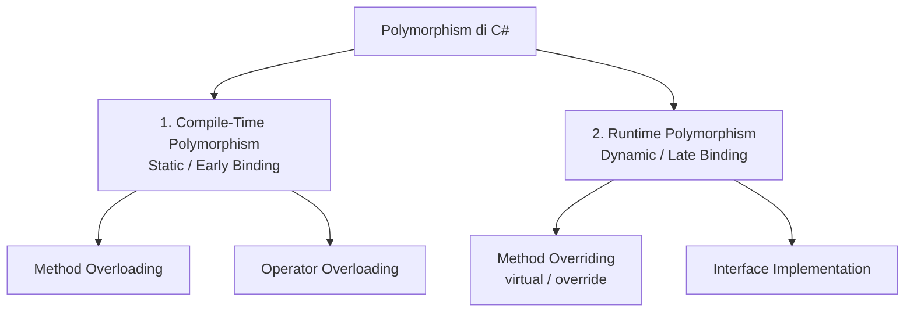
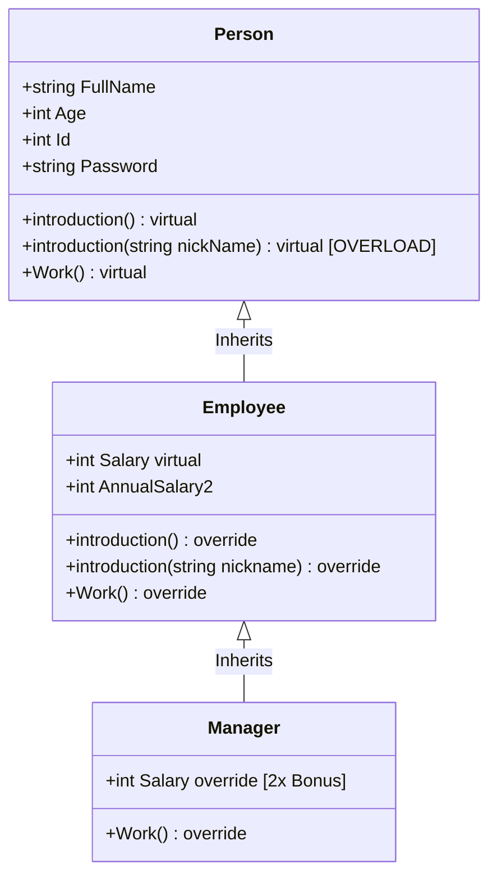
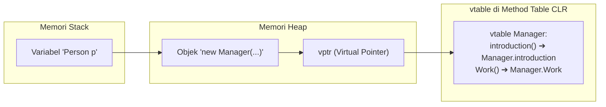

# PANDUAN LENGKAP POLYMORPHISM DI C# (.NET)
> **Materi:** Bootcamp Backend .NET - Series B (Object-Oriented Programming)  
> **Studi Kasus:** `SeriesB.DPolymorphism` (`Person` ➔ `Employee` ➔ `Manager`)

---

## DAFTAR ISI
1. [Apa Itu Polymorphism?](#1-apa-itu-polymorphism)
2. [Analogi Dunia Nyata](#2-analogi-dunia-nyata)
3. [Dua Jenis Polymorphism di C#](#3-dua-jenis-polymorphism-di-c)
4. [Tabel Komparasi: Overloading vs Overriding](#4-tabel-komparasi-overloading-vs-overriding)
5. [Bedah Kode Nyata (DPolymorphism)](#5-bedah-kode-nyata-dpolymorphism)
   - [A. Person.cs (Parent / Base Class)](#a-personcs-parent--base-class)
   - [B. Employee.cs (Child / Derived Class)](#b-employeecs-child--derived-class)
   - [C. Manager.cs (Grandchild / Sub-derived Class)](#c-managercs-grandchild--sub-derived-class)
   - [D. Example04.cs (Demo Polimorfisme)](#d-example04cs-demo-polimorfisme)
6. [Apa yang Terjadi di Balik Layar? (Memory & vtable)](#6-apa-yang-terjadi-di-balik-layar-memory--vtable)
7. [Kesalahan Umum Pemula (Common Pitfalls)](#7-kesalahan-umum-pemula-common-pitfalls)
8. [Penerapannya di Industri Backend .NET](#8-penerapannya-di-industri-backend-net)

---

## 1. APA ITU POLYMORPHISM?

Secara bahasa, **Polymorphism** berasal dari dua kata Yunani kuno:
* **Poly** = Banyak
* **Morph** = Bentuk

> **Definisi:**  
> **Polymorphism** adalah prinsip OOP di mana **satu nama antarmuka/method yang sama dapat memiliki banyak bentuk perilaku yang berbeda**, tergantung objek apa yang menjalankannya.

Dengan polimorfisme, kode program kita menjadi sangat fleksibel dan *extensible* (mudah diperluas tanpa merusak kode lama).

---

## 2. ANALOGI DUNIA NYATA

### Analogi 1: Tombol "Power / Start"
Bayangkan sebuah tombol berlambang **Power (⏻)**:
* Di **Mobil**, menekan tombol Power akan menyalakan mesin bensin dan pompa oli.
* Di **Mesin Cuci**, menekan tombol Power akan memutar drum dan mengisi air.
* Di **Komputer**, menekan tombol Power akan menjalankan BIOS dan memuat sistem operasi.

> Tombol antarmukanya **persis sama (`Start()`)**, tapi **cara kerjanya di balik layar berbeda-beda** sesuai jenis mesinnya.

### Analogi 2: Perintah "Bekerja" (`Work()`)
* **Person biasa:** Bekerja = Menyapu rumah atau belanja.
* **Employee:** Bekerja = Mengerjakan tugas di meja kantor.
* **Manager:** Bekerja = Memimpin rapat dan mengawasi project tim.

---

## 3. DUA JENIS POLYMORPHISM DI C#

Di ekosistem .NET, Polymorphism terbagi menjadi dua kategori besar:



### A. Compile-Time Polymorphism (Static Binding)
* Terjadi dan ditentukan **saat kode dikompilasi** (`dotnet build`).
* Compiler sudah tahu persis method mana yang akan dipanggil berdasarkan **tipe dan jumlah argumen**.
* Contoh utama: **Method Overloading**.

### B. Runtime Polymorphism (Dynamic Binding)
* Terjadi dan ditentukan **saat aplikasi sedang berjalan di memori**.
* Method yang dieksekusi ditentukan oleh **tipe objek asli yang ada di Heap**, bukan tipe variabel wadahnya di Stack.
* Syarat: Menggunakan pasangan keyword **`virtual`** pada class induk dan **`override`** pada class anak.
* Contoh utama: **Method Overriding**.

---

## 4. TABEL KOMPARASI: OVERLOADING VS OVERRIDING

| Pembeda | Method Overloading (Compile-Time) | Method Overriding (Runtime) |
|---|---|---|
| **Definisi** | Nama method sama, tetapi parameter berbeda. | Class anak menulis ulang isi method bapaknya. |
| **Lokasi** | Terjadi di **class yang sama** (atau class turunan). | Terjadi di **antar class** (Inheritance: Parent ➔ Child). |
| **Signature Method** | **Harus berbeda** (jumlah/tipe/urutan parameter). | **Harus sama persis** (nama, parameter, return type). |
| **Keyword** | Tidak butuh keyword khusus. | Wajib menggunakan **`virtual`** dan **`override`**. |
| **Waktu Penentuan** | Saat proses kompilasi (*Early Binding*). | Saat program sedang berjalan (*Late Binding*). |
| **Tujuan** | Fleksibilitas input (bisa panggil dengan berbagai variasi argumen). | Kustomisasi perilaku spesifik sesuai anak class-nya. |

---

## 5. BEDAH KODE NYATA (DPOLYMORPHISM)

Mari kita bedah arsitektur kode yang kita buat di folder `SeriesB/DPolymorphism`:



---

### A. Person.cs (Parent / Base Class)

File ini menjadi fondasi utama tempat kita menyiapkan *kontrak virtual*:

```csharp
namespace SeriesB.DPolymorphism;

public class Person
{
    public string FullName { get; set; }
    public int Age { get; set; }
    public int Id { get; protected set; }
    public string Password { protected get; set; }

    // Constructor Chaining: constructor kecil memanggil constructor lengkap
    public Person() { }

    public Person(int id, string fullName, int age, string password)
    {
        Id = id;
        FullName = fullName;
        Age = age;
        Password = password;
    }

    public Person(string fullName, int age, string password) 
        : this(0, fullName, age, password) { }

    // 1. METHOD VIRTUAL: Membuka izin agar boleh di-override anak
    public virtual void introduction()
    {
        Console.WriteLine($"[Person] Nama: {FullName} | Umur: {Age} tahun | ID: {Id}");
    }

    // 2. METHOD OVERLOAD: Nama sama, parameter berbeda
    public virtual void introduction(string nickName)
    {
        Console.WriteLine($"[Person] Nama: {FullName} ({nickName}) | Umur: {Age} tahun | ID: {Id}");
    }

    // 3. BEHAVIOR METHOD VIRTUAL
    public virtual void Work()
    {
        Console.WriteLine($"{FullName} sedang melakukan kegiatan sehari-hari.");
    }
}
```

> **Sorotan Kunci:**
> - Keyword `virtual` adalah **pemberian izin resmi** dari bapak kepada anak-anaknya: *"Anakku, silakan modifikasi method ini kalau kamu butuh cara kerja yang berbeda!"*
> - Jika tidak ada kata `virtual`, anak **dilarang keras** me-`override`.

---

### B. Employee.cs (Child / Derived Class)

`Employee` mewarisi `Person`, lalu mengubah perilakunya lewat `override`:

```csharp
namespace SeriesB.DPolymorphism;

public class Employee : Person
{
    // Property virtual: Gaji bisa dimodifikasi oleh Manager nanti
    public virtual int Salary
    {
        get => field;
        set => field = value <= 0 ? 0 : value;
    } 

    public int AnnualSalary2 => Salary * 12;

    // Constructor Chaining ke Bapak (: base)
    public Employee(int id, string fullName, int age, string password, int salary)
        : base(id, fullName, age, password) // Panggil constructor Person
    {
        Salary = salary;
    }

    // 1. OVERRIDE METHOD TANPA PARAMETER
    public override void introduction()
    {
        base.introduction(); // Panggil tulisan nama & umur milik Person dulu
        Console.WriteLine($"   └── [Jabatan: Employee] Gaji: Rp {Salary:N0}");
    }

    // 2. OVERRIDE METHOD DENGAN PARAMETER
    public override void introduction(string nickname)
    {
        base.introduction(nickname);
        Console.WriteLine($"   └── [Jabatan: Employee] Gaji: Rp {Salary:N0}");
    }

    // 3. OVERRIDE BEHAVIOR METHOD
    public override void Work()
    {
        Console.WriteLine($"{FullName} sedang sibuk bekerja menyelesaikan tugas kantor.");
    }
}
```

> **Sorotan Kunci:**
> - `base.introduction()`: Digunakan agar kita **tidak menduplikasi kode**. Kita panggil dulu cetak nama & umur dari `Person`, lalu tinggal tambah informasi gaji di bawahnya.
> - Keyword `override` memberi tahu compiler: *"Saya secara sadar mengganti implementasi method virtual milik bapak saya."*

---

### C. Manager.cs (Grandchild / Sub-derived Class)

`Manager` adalah turunan dari `Employee`. Menunjukkan bahwa hierarki polimorfisme bisa bertingkat:

```csharp
namespace SeriesB.DPolymorphism;

public class Manager : Employee
{
    public Manager(int id, string fullName, int age, string password, int salary)
        : base(id, fullName, age, password, salary)
    {
    }

    // OVERRIDE PROPERTY: Manager otomatis dapat gaji 2x lipat
    public override int Salary
    {
        get => base.Salary;
        set
        {
            if (value <= 0)
                Console.WriteLine("Salary must be greater than zero");
            else
                base.Salary = value * 2; // Pengali 2x lipat khusus Manager
        }
    }

    // OVERRIDE METHOD WORK KHUSUS MANAGER
    public override void Work()
    {
        Console.WriteLine($"{FullName} (Manager) sedang memimpin meeting dan mengawasi project tim.");
    }
}
```

> **Sorotan Kunci:**
> - Di sini kita membuktikan bahwa **Property juga bisa di-override**, bukan cuma method!
> - Saat `Salary` diset 15.000.000, di dalam `base.Salary` nilainya otomatis tersimpan 30.000.000.

---

### D. Example04.cs (Demo Eksekusi Polimorfisme)

File ini mendemokan ketiga aspek secara berurutan:

```csharp
namespace SeriesB.DPolymorphism;

internal class Example04
{
    public void PolymorphismExample()
    {
        // -------------------------------------------------------------
        // 1. DEMO OVERLOADING (Compile-time)
        // -------------------------------------------------------------
        Person fathan = new Person(1, "Fathan Nuhi", 22, "pass123");
        fathan.introduction();         // Memanggil overload (tanpa nickname)
        fathan.introduction("Nuhi");   // Memanggil overload (pakai nickname)

        // -------------------------------------------------------------
        // 2. DEMO OVERRIDING (Runtime)
        // -------------------------------------------------------------
        Employee budi = new Employee(101, "Budi Santoso", 28, "pass456", 8_500_000);
        budi.introduction("Budi");     // Memanggil versi Employee

        // -------------------------------------------------------------
        // 3. DEMO POLIMORFISME SEJATI: SATU TIPE REFERENSI, BANYAK BENTUK
        // -------------------------------------------------------------
        // Array bertipe Person, tapi menampung Person, Employee, dan Manager!
        Person[] daftarWarga = new Person[]
        {
            new Person(2, "Siti Rahma", 20, "pass789"),
            new Employee(102, "Ahmad Dani", 30, "pass999", 10_000_000),
            new Manager(201, "Pak Hendra", 42, "bos123", 15_000_000)
        };

        foreach (Person p in daftarWarga)
        {
            // DI SINI KEAJAIBAN POLIMORFISME TERJADI:
            // Tipe variabel di kodingan adalah 'Person',
            // tapi yang dijalankan adalah method milik objek aslinya!
            p.introduction();
            p.Work();
            Console.WriteLine();
        }
    }
}
```

---

## 6. APA YANG TERJADI DI BALIK LAYAR? (MEMORY & VTABLE)

Bagaimana C# bisa tahu bahwa `p.Work()` harus menjalankan method milik `Manager` saat loop mencapai objek ke-3, padahal tipe variabelnya adalah `Person p`?



1. **Stack:** Hanya menyimpan pointer bertipe `Person p`.
2. **Heap:** Menyimpan objek riil hasil `new Manager(...)`.
3. **vptr & vtable (Virtual Method Table):** Setiap class yang punya method `virtual` / `override` memiliki tabel tersembunyi bernama **vtable**.
4. Saat program berjalan (*Runtime*), CLR (Common Language Runtime) melihat pointer `vptr` dari objek di Heap, mengecek vtable milik `Manager`, dan langsung meloncat ke method `Manager.Work()`.

---

## 7. KESALAHAN UMUM PEMULA (COMMON PITFALLS)

### ❌ 1. Lupa kata `virtual` di Parent
```csharp
// DI PARENT:
public void introduction() { ... } // TIDAK ADA VIRTUAL

// DI CHILD:
public override void introduction() { ... } // 💥 ERROR CS0506!
```
*Solusi:* Parent **wajib** bertanda `virtual`, `abstract`, atau `override`.

---

### ❌ 2. Method Hiding / Shadowing (Lupa `override`)
```csharp
// DI PARENT:
public virtual void introduction() { ... }

// DI CHILD:
public void introduction() { ... } // Lupa ketik 'override'
```
*Dampaknya:* Muncul warning `CS0108`. Jika objek diakses lewat variabel `Person p = new Employee()`, method yang terpanggil adalah **milik Person**, bukan Employee!

---

### ❌ 3. Parameter `: base(...)` Tertukar
```csharp
public Employee(int id, string name, string password, int salary)
public Manager(int id, string name, int salary, string password)
    : base(id, name, salary, password) // 💥 ERROR TIPE DATA SALAH
```
*Solusi:* Selalu cocokkan tipe data dan urutan parameter sesuai constructor parent-nya.

---

## 8. PENERAPANNYA DI INDUSTRI BACKEND .NET

Di dunia kerja nyata (misal saat nanti kamu masuk materi ASP.NET Core & Entity Framework):

### 1. Payment Gateway Service
```csharp
public interface IPaymentGateway // atau abstract class
{
    void ProcessPayment(decimal amount);
}

public class MidtransPayment : IPaymentGateway { public void ProcessPayment(...) { ... } }
public class XenditPayment   : IPaymentGateway { public void ProcessPayment(...) { ... } }
```
Aplikasi kasir hanya memanggil `_gateway.ProcessPayment(total)`. Mau pakai Midtrans atau Xendit, kodingan checkout tidak perlu diubah-ubah!

### 2. Export Laporan (PDF / Excel / CSV)
```csharp
public abstract class ReportGenerator
{
    public abstract void GenerateFile();
}

public class PdfReport : ReportGenerator { ... }
public class ExcelReport : ReportGenerator { ... }
```

---

> **Kata Kunci untuk Diingat:**  
> - **Overload** = Nama sama, beda parameter, di class yang sama (Compile-Time).  
> - **Override** = Nama sama, parameter sama, beda class (Parent-Child), pakai `virtual` dan `override` (Runtime).  
> - **Polimorfisme** = Satu remote kontrol (`Person`), bisa mengendalikan banyak jenis perangkat (`Person`, `Employee`, `Manager`) sesuai sifat aslinya.
